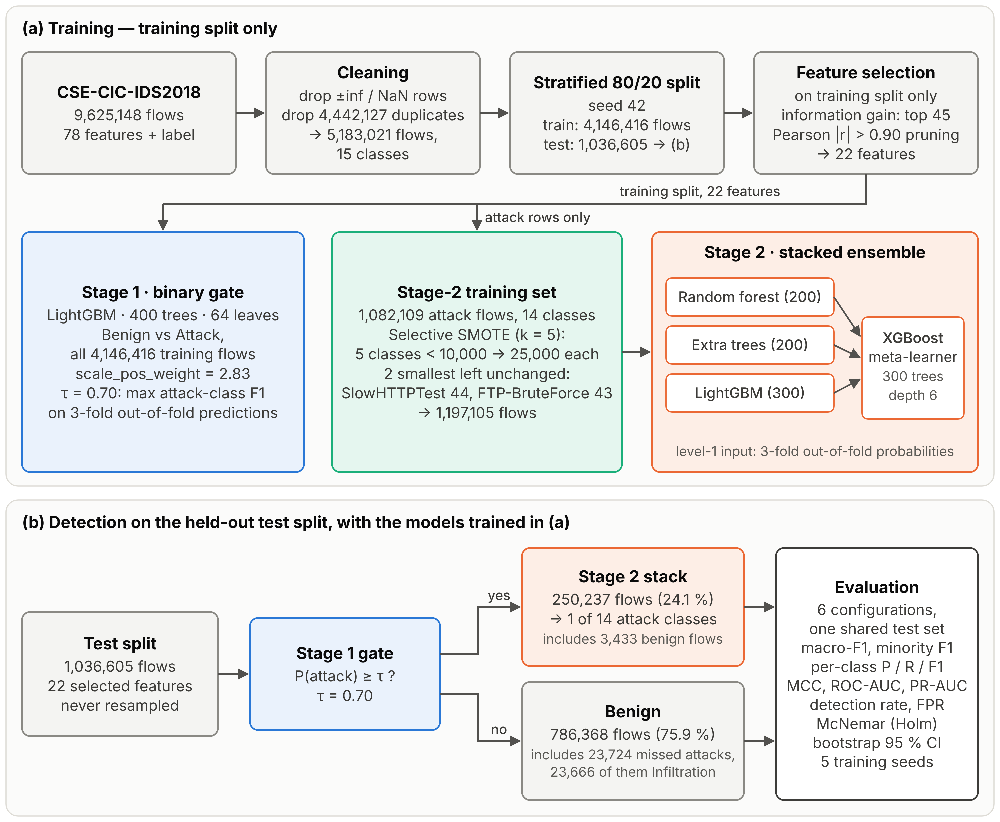

# Two-stage network intrusion detection with selective SMOTE (CSE-CIC-IDS2018)

Code and reported results for the paper
**"<paper title>"**, <authors>, submitted to ICRASST 2026.

A LightGBM gate separates benign from attack flows (Stage 1). Flows it flags go to a stacked
ensemble — random forest, extra trees and LightGBM, with an XGBoost meta-learner — that assigns one
of 14 attack classes (Stage 2). SMOTE is applied only to Stage-2 attack classes with fewer than
10,000 training flows, except the two smallest (SlowHTTPTest, FTP-BruteForce).



## Contents

| Path | What it is |
|---|---|
| `nids_two_stage_smote_pipeline.ipynb` | Full pipeline: preprocessing, feature selection, six configurations, statistics, figures |
| `build_dataset.py` | Builds `combined_dataset.csv` from the Mendeley release (below) |
| `requirements.txt` | Library versions used for the reported results |
| `results_reported/` | Every table, log and figure from the run reported in the paper |
| `docs/fig1_pipeline.png` | Pipeline figure (Fig. 1 of the paper) |

## Data

The input is the cleaned CSE-CIC-IDS2018 release on Mendeley Data:

> Mohamed, A. (2024). *CSE-CIC-IDS2018* [Data set]. Mendeley Data, V1. https://doi.org/10.17632/29hdbdzx2r.1 (CC BY 4.0)

It is derived from the original dataset of the Canadian Institute for Cybersecurity
(Sharafaldin, Lashkari and Ghorbani, ICISSP 2018; https://www.unb.ca/cic/datasets/ids-2018.html).
The release consists of 14 CSV files, one per attack class; benign flows are contained in these
files, since there is no separate benign file. The release does not document its cleaning steps;
the files have 78 numeric flow features and a `Label` column, and no identifier columns.
The data are not redistributed here.

Build the input file:

```bash
# 1. download CSE-CIC-IDS2018.zip from https://data.mendeley.com/datasets/29hdbdzx2r/1 and extract it
# 2. concatenate the 14 files (sorted by file name)
python build_dataset.py --src /path/to/extracted --out combined_dataset.csv
```

The script prints rows per file, labels per file, duplicate rows within and across files, and an
`input_fingerprint`. The pipeline logs the same fingerprint in `results/preprocessing_log.json`.
Row order determines the train/test split, so the same fingerprint means the same split.

| | Reported run |
|---|---|
| Rows × columns in `combined_dataset.csv` | 9,625,148 × 79 |
| `input_fingerprint` | `<fill in: output of build_dataset.py --compare on the file used for the reported run>` |
| Exact duplicate rows removed by the pipeline | 4,442,127 |
| Flows after cleaning | 5,183,021 (train 4,146,416 / test 1,036,605) |

Class counts after duplicate removal (`results_reported/table_class_distribution.csv`):

| Class | All | Train | Test |
|---|---:|---:|---:|
| Benign | 3,830,384 | 3,064,307 | 766,077 |
| DDoS attacks-LOIC-HTTP | 575,364 | 460,291 | 115,073 |
| DDOS attack-HOIC | 198,861 | 159,089 | 39,772 |
| DoS attacks-Hulk | 145,199 | 116,159 | 29,040 |
| Bot | 144,535 | 115,628 | 28,907 |
| Infilteration | 140,610 | 112,488 | 28,122 |
| SSH-Bruteforce | 94,048 | 75,238 | 18,810 |
| DoS attacks-GoldenEye | 41,406 | 33,125 | 8,281 |
| DoS attacks-Slowloris | 9,908 | 7,926 | 1,982 |
| DDOS attack-LOIC-UDP | 1,730 | 1,384 | 346 |
| Brute Force -Web | 555 | 444 | 111 |
| Brute Force -XSS | 228 | 183 | 45 |
| SQL Injection | 84 | 67 | 17 |
| DoS attacks-SlowHTTPTest | 55 | 44 | 11 |
| FTP-BruteForce | 54 | 43 | 11 |

Class names keep the dataset's spelling (e.g. `Infilteration`).

## Running

**Google Colab (as reported).** Use a high-memory CPU runtime, upload the notebook, put
`combined_dataset.csv` in Google Drive and run all cells. The first cell installs the pinned
versions; if it changes numpy, pandas or scikit-learn, restart the runtime once and run again.
Checkpoints are written to Drive, so after a disconnect, rerunning all cells resumes from the last
finished step.

**Locally.**

```bash
pip install -r requirements.txt notebook
export NIDS_DATA_PATH=/path/to/combined_dataset.csv
export NIDS_OUT_DIR=/path/to/output
jupyter nbconvert --to notebook --execute nids_two_stage_smote_pipeline.ipynb
```

Outside Colab the Drive cell does nothing, and the install cell installs the versions in `requirements.txt`.

**Hardware and time for the reported run:** 44 vCPU AMD EPYC 9B14, 186 GB RAM, no GPU. Total about
1.5–2 hours. Largest single steps: flat stacked ensembles A2 and A3 (about 19–20 min each to train),
Stage-2 stack about 4–6 min per fit (11 fits including seed repeats). Peak memory is set by loading
the 9.6M-row CSV and training the flat stacks on 4.1M rows.

The configuration cell controls everything: `SEED`, feature-selection settings, SMOTE settings
(`MINORITY_CUTOFF`, `AUG_TARGET`, `SMOTE_EXCLUDE`), the threshold criterion, which configurations
run, `SEEDS_REPEAT`, `N_BOOT`, `FORCE_RETRAIN`, `SAVE_MODELS`.

## Configurations

All six are evaluated on the same untouched, imbalanced 20 % test split.

| Code | Model | SMOTE |
|---|---|---|
| A1 | Random forest, 15 classes | none (class-weighted) |
| A2 | Stacked ensemble, 15 classes | none |
| A3 | Stacked ensemble, 15 classes | selective |
| B1 | Two-stage | none |
| **B2** | **Two-stage (proposed)** | **selective, Stage-2 training data only** |
| B3 | Two-stage | all attack classes < 10,000 flows, including the two smallest |

## Outputs

Written to `<NIDS_OUT_DIR>/results/` and zipped as `results.zip`. The run reported in the paper is in
`results_reported/`.

| File | Content |
|---|---|
| `table_ablation.csv` | All six configurations: macro-F1, minority-class macro-F1, weighted F1, accuracy, MCC, ROC-AUC, PR-AUC, detection rate, benign FPR, training time, batch inference time per flow |
| `table_per_class_f1_all_arms.csv`, `per_class_<arm>.csv` | Per-class F1 (and precision, recall, support) |
| `confusion_matrix_<arm>.csv` | 15 × 15 confusion matrices |
| `table_gate_binary.csv` | Stage-1 gate metrics on training OOF and test, at the chosen threshold and at 0.5 |
| `gate_threshold_selection_oof.csv` | Threshold grid on out-of-fold training predictions |
| `table_stage2_isolated.csv`, `per_class_stage2_isolated_<arm>.csv` | Stage 2 on true attack flows only |
| `table_mcnemar.csv` | McNemar tests, proposed vs each configuration, Holm-corrected |
| `table_bootstrap_ci.csv` | Bootstrap 95 % CIs and paired differences |
| `table_seed_repeats.csv`, `table_seed_summary.csv` | B1 vs B2 over five training seeds |
| `table_threshold_sensitivity.csv` | Test-set threshold sweep (sensitivity analysis only) |
| `table_class_distribution.csv` | Class counts, including Stage-2 training counts after SMOTE |
| `table_feature_selection.csv` | Information-gain ranking, selected features, correlation drops |
| `table_train_test_overlap.csv` | Test flows whose feature vector also occurs in training, per class |
| `preprocessing_log.json`, `environment.json` | Cleaning counts, input fingerprint, versions, hardware, configuration |
| `paper_tables.xlsx` | All tables in one workbook |
| `figures/*.png` | Feature ranking, Stage-2 class distribution, gate ROC/PR, per-class F1, confusion matrix, threshold sensitivity |

## Reproducibility notes

* Feature selection, SMOTE, threshold selection and training use the training split only; the test split is never resampled.
* The gate threshold (0.70 in the reported run) is chosen on 3-fold out-of-fold training predictions by maximising attack-class F1.
* McNemar tests and bootstrap intervals use the seed-42 run. Seed repeats retrain Stage 2 (and SMOTE) only; split, features, gate and threshold are fixed.
* Reruns with other library versions or thread counts can differ in the last decimals (LightGBM is not bit-for-bit deterministic unless `deterministic=True`).
* `results_reported/` was produced by the previous revision of this notebook. Differences, none of which change results:
  it passed `subsample=0.8` to the gate (ignored by LightGBM without `subsample_freq`); it named batch inference time `latency_us_per_flow`;
  two tables have an unnamed first column; it did not log `input_fingerprint`.

## Known limitations

* SMOTE runs before stacking, so synthetic flows enter the stack's internal 3-fold cross-validation and the meta-learner sees optimistic level-0 probabilities for oversampled classes. Test results are unaffected.
* Pearson pruning drops a feature correlated (|r| > 0.90) with any higher-ranked feature, including features that were themselves dropped.
* Mutual information is estimated on a 300,000-row random sample, which holds only a few flows of the rarest classes.
* SMOTE interpolates `Dst Port` as a continuous value. `Pkt Len Std` and `Pkt Len Var` are both kept, since their relationship is not linear.
* After duplicate removal, 19,120 distinct feature vectors still occur with more than one label, and 0.76 % of test flows (11.8 % of Infiltration test flows) have an identical feature vector in the training split (`table_train_test_overlap.csv`).

## Citation

If you use this code, please cite the paper (details to be added on acceptance) and the dataset:

```bibtex
@misc{mohamed2024cseids2018,
  author = {Mohamed, Abdisalam},
  title  = {{CSE-CIC-IDS2018}},
  year   = {2024},
  publisher = {Mendeley Data},
  version = {V1},
  doi    = {10.17632/29hdbdzx2r.1}
}
@inproceedings{sharafaldin2018ids,
  author    = {Sharafaldin, Iman and Lashkari, Arash Habibi and Ghorbani, Ali A.},
  title     = {Toward Generating a New Intrusion Detection Dataset and Intrusion Traffic Characterization},
  booktitle = {Proceedings of the 4th International Conference on Information Systems Security and Privacy (ICISSP)},
  pages     = {108--116},
  year      = {2018}
}
```

## License

Code: MIT (see `LICENSE`). The dataset is not included; it is licensed CC BY 4.0 by its authors.
